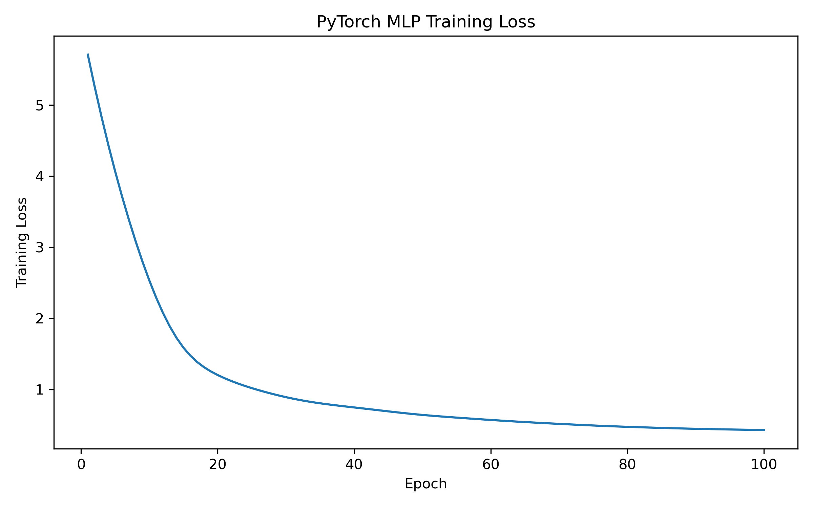

# First part:
To run the code go to the folder ./Intro_deep_learning, and run from terminal: python ./hw2.py

# Second part
# California Housing: Model Comparison

## Dataset Exploration

### 1. Load Dataset

The California Housing dataset was loaded using
`fetch_california_housing()` from `sklearn.datasets`.

### 2. Dataset Description

```text
.. _california_housing_dataset:

California Housing dataset
--------------------------

**Data Set Characteristics:**

:Number of Instances: 20640

:Number of Attributes: 8 numeric, predictive attributes and the target

:Attribute Information:
    - MedInc        median income in block group
    - HouseAge      median house age in block group
    - AveRooms      average number of rooms per household
    - AveBedrms     average number of bedrooms per household
    - Population    block group population
    - AveOccup      average number of household members
    - Latitude      block group latitude
    - Longitude     block group longitude

:Missing Attribute Values: None

This dataset was obtained from the StatLib repository.
https://www.dcc.fc.up.pt/~ltorgo/Regression/cal_housing.html

The target variable is the median house value for California districts,
expressed in hundreds of thousands of dollars ($100,000).

This dataset was derived from the 1990 U.S. census, using one row per census
block group. A block group is the smallest geographical unit for which the U.S.
Census Bureau publishes sample data (a block group typically has a population
of 600 to 3,000 people).

A household is a group of people residing within a home. Since the average
number of rooms and bedrooms in this dataset are provided per household, these
columns may take surprisingly large values for block groups with few households
and many empty houses, such as vacation resorts.

It can be downloaded/loaded using the
:func:`sklearn.datasets.fetch_california_housing` function.

.. rubric:: References

- Pace, R. Kelley and Ronald Barry, Sparse Spatial Autoregressions,
  Statistics and Probability Letters, 33:291-297, 1997.

```

### 3. DataFrame

The dataset features and target variable were stored in a
Pandas DataFrame. The target variable is `MedHouseVal`.

### 4. First Five Rows

```text
   MedInc  HouseAge  AveRooms  AveBedrms  Population  AveOccup  Latitude  Longitude  MedHouseVal
0  8.3252      41.0  6.984127   1.023810       322.0  2.555556     37.88    -122.23        4.526
1  8.3014      21.0  6.238137   0.971880      2401.0  2.109842     37.86    -122.22        3.585
2  7.2574      52.0  8.288136   1.073446       496.0  2.802260     37.85    -122.24        3.521
3  5.6431      52.0  5.817352   1.073059       558.0  2.547945     37.85    -122.25        3.413
4  3.8462      52.0  6.281853   1.081081       565.0  2.181467     37.85    -122.25        3.422
```

### 5. Descriptive Statistics

```text
             MedInc      HouseAge      AveRooms     AveBedrms    Population      AveOccup      Latitude     Longitude   MedHouseVal
count  20640.000000  20640.000000  20640.000000  20640.000000  20640.000000  20640.000000  20640.000000  20640.000000  20640.000000
mean       3.870671     28.639486      5.429000      1.096675   1425.476744      3.070655     35.631861   -119.569704      2.068558
std        1.899822     12.585558      2.474173      0.473911   1132.462122     10.386050      2.135952      2.003532      1.153956
min        0.499900      1.000000      0.846154      0.333333      3.000000      0.692308     32.540000   -124.350000      0.149990
25%        2.563400     18.000000      4.440716      1.006079    787.000000      2.429741     33.930000   -121.800000      1.196000
50%        3.534800     29.000000      5.229129      1.048780   1166.000000      2.818116     34.260000   -118.490000      1.797000
75%        4.743250     37.000000      6.052381      1.099526   1725.000000      3.282261     37.710000   -118.010000      2.647250
max       15.000100     52.000000    141.909091     34.066667  35682.000000   1243.333333     41.950000   -114.310000      5.000010
```


## Model Development

The dataset was divided into training and testing sets using an
80/20 split with `random_state=0`.

The predictor variables were standardized using
`StandardScaler`, fitted only on the training data.

Two models were trained:

1. Linear Regression using scikit-learn
2. A Multi-Layer Perceptron (MLP) implemented using PyTorch


## Performance Comparison

| Model | MSE | RMSE | R² |
|---|---:|---:|---:|
| Linear Regression | 0.528984 | 0.727313 | 0.594323 |
| PyTorch MLP | 0.426274 | 0.652896 | 0.673092 |

### Analysis

The PyTorch MLP achieved a lower RMSE than Linear Regression on the test set.

The MSE, RMSE, and R² metrics all show better performance with the PyTorch MLP than 
with linear regression. This is likely because the data do not share a linear relationship, 
and the MLP is better able to capture any non-linearity present between the variables.

## PyTorch Training Loss

The PyTorch MLP was trained for 100 epochs using the Adam
optimizer with a learning rate of 0.01 and mean squared error
loss. It can be seen that, in each iteration, the value of the objective function decreases, 
such that the MLP parameters move closer to the model's optimal parameters.

The training loss is shown below.


