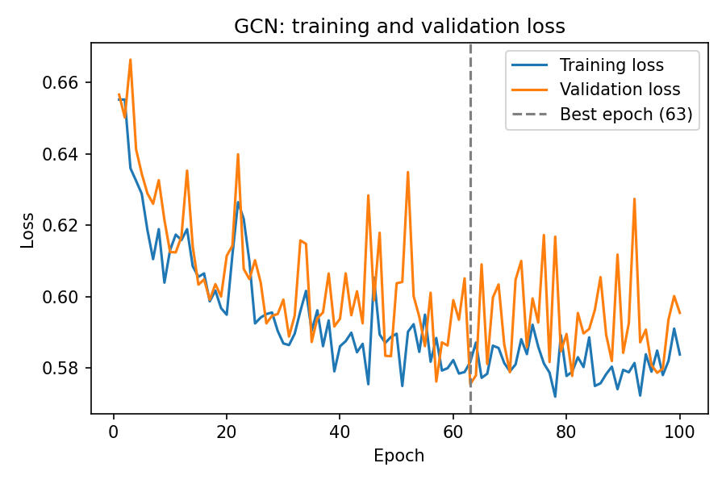
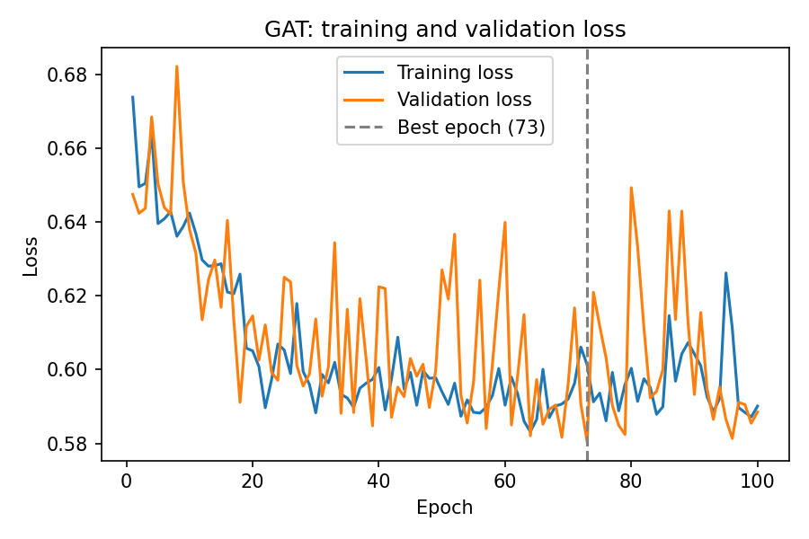

# GNN for Classification on PROTEINS (TUDataset)

This project uses a Graph Convolutional Network (GCN) and a Graph Attention Network (GAT) to classify proteins as enzymes or non-enzymes.

## Part 1: Data Loading and Exploration

### Dataset information

|Property|Value|
|---|---|
|Total number of graphs| 1113 |
|Number of classes| 2 |
|Number of node features| 3 |

### First graph (`dataset[0]`)
```
Data(edge_index=[2, 162], x=[42, 3], y=[1])
```
**Node feature matrix `x`** — shape: `(42, 3)`
```
tensor([[1., 0., 0.],
        [1., 0., 0.],
        [1., 0., 0.],
        [1., 0., 0.],
        [1., 0., 0.],
        [1., 0., 0.],
        [1., 0., 0.],
        [1., 0., 0.],
        [1., 0., 0.],
        [1., 0., 0.],
        [1., 0., 0.],
        [1., 0., 0.],
        [1., 0., 0.],
        [1., 0., 0.],
        [1., 0., 0.],
        [1., 0., 0.],
        [1., 0., 0.],
        [1., 0., 0.],
        [1., 0., 0.],
        [1., 0., 0.],
        [1., 0., 0.],
        [1., 0., 0.],
        [0., 1., 0.],
        [0., 1., 0.],
        [0., 1., 0.],
        [0., 1., 0.],
        [0., 1., 0.],
        [0., 1., 0.],
        [0., 1., 0.],
        [0., 1., 0.],
        [0., 1., 0.],
        [0., 1., 0.],
        [0., 1., 0.],
        [0., 1., 0.],
        [0., 1., 0.],
        [0., 1., 0.],
        [0., 1., 0.],
        [0., 1., 0.],
        [0., 1., 0.],
        [0., 1., 0.],
        [0., 1., 0.],
        [0., 1., 0.]])
```
**Edge index `edge_index`** — shape: `(2, 162)`
```
tensor([[ 0,  0,  0,  1,  1,  1,  2,  2,  2,  3,  3,  3,  3,  3,  4,  4,  4,  4,
          4,  4,  5,  5,  5,  6,  6,  6,  7,  7,  7,  7,  8,  8,  8,  8,  8,  9,
          9,  9,  9,  9,  9, 10, 10, 10, 11, 11, 11, 12, 12, 12, 13, 13, 13, 13,
         14, 14, 14, 14, 15, 15, 15, 16, 16, 16, 16, 17, 17, 17, 18, 18, 18, 18,
         19, 19, 19, 19, 19, 19, 19, 19, 20, 20, 20, 21, 21, 21, 22, 22, 22, 22,
         23, 23, 23, 23, 23, 24, 24, 24, 25, 25, 25, 26, 26, 26, 27, 27, 27, 28,
         28, 28, 29, 29, 29, 30, 30, 30, 31, 31, 31, 31, 31, 31, 32, 32, 32, 32,
         33, 33, 33, 33, 33, 34, 34, 34, 34, 35, 35, 35, 35, 36, 36, 36, 37, 37,
         37, 38, 38, 38, 38, 39, 39, 39, 39, 40, 40, 40, 41, 41, 41, 41, 41, 41],
        [11, 22, 32, 23, 31, 41, 24, 29, 34,  4, 28, 29, 38, 39,  3, 14, 28, 29,
         38, 39,  6,  7, 26,  5,  7,  8,  5,  6, 19, 25,  6,  9, 10, 25, 35,  8,
         10, 19, 21, 25, 35,  8,  9, 20,  0, 22, 32, 31, 33, 41, 14, 15, 34, 39,
          4, 13, 15, 39, 13, 14, 38, 17, 18, 19, 36, 16, 18, 19, 16, 17, 19, 35,
          7,  9, 16, 17, 18, 20, 21, 35, 10, 19, 21,  9, 19, 20,  0, 11, 30, 40,
          1, 24, 31, 34, 41,  2, 23, 33,  7,  8,  9,  5, 27, 37, 26, 28, 36,  3,
          4, 27,  2,  3,  4, 22, 31, 32,  1, 12, 23, 30, 33, 41,  0, 11, 30, 40,
         12, 24, 31, 34, 41,  2, 13, 23, 33,  8,  9, 18, 19, 16, 27, 37, 26, 36,
         38,  3,  4, 15, 37,  3,  4, 13, 14, 22, 32, 41,  1, 12, 23, 31, 33, 40]])
```
**Graph label `y`**
```
tensor([0])
```
### Average number of nodes per graph

**39.06** nodes per graph.

## Part 2: Train, Validation, Test Split

|Dataset|Number of graphs
|---|---|---|
|Training|778|
|Validation|112|
|Test|223|

- **Random seed:** `random_state=0`

## Part 3: Model Building and Training

### Mini-batches

| Loader | Graphs | Mini-batches |
|---|---|---|
| Training | 778 | 25 |
| Validation | 112 | 4 |
| Test | 223 | 7 |

Example training mini-batch:
```
DataBatch(edge_index=[2, 5608], x=[1545, 3], y=[32], batch=[1545], ptr=[33])
```
- `x` shape: `(1545, 3)` (`[num_nodes, num_features]`)
- `edge_index` shape: `(2, 5608)` (`[2, num_edges]`)
- `batch` shape: `(1545,)` (graph index of each node)
- `y` shape: `(32,)` (one label per graph)

### Model 1: GCN

Two `GCNConv` layers (ReLU, dropout 0.5 after the first), `global_mean_pool`, and a `Linear` output layer.

- `in_channels` = 3, `hidden_channels` = 64, `num_classes` = 2
- Loss: `CrossEntropyLoss`, optimizer: `Adam` (lr = 0.01), epochs: 100, batch size: 32
- **Best checkpoint:** epoch 63 (validation loss = 0.5755)

Training progress (every 10 epochs):
```
Epoch  10 | Train Loss: 0.6131 | Val Loss: 0.6125
Epoch  20 | Train Loss: 0.5950 | Val Loss: 0.6115
Epoch  30 | Train Loss: 0.5869 | Val Loss: 0.5992
Epoch  40 | Train Loss: 0.5861 | Val Loss: 0.5938
Epoch  50 | Train Loss: 0.5896 | Val Loss: 0.6038
Epoch  60 | Train Loss: 0.5822 | Val Loss: 0.5990
Epoch  70 | Train Loss: 0.5791 | Val Loss: 0.5788
Epoch  80 | Train Loss: 0.5778 | Val Loss: 0.5896
Epoch  90 | Train Loss: 0.5795 | Val Loss: 0.5843
Epoch 100 | Train Loss: 0.5838 | Val Loss: 0.5955
```



### Model 2: GAT

Two `GATConv` layers (first with 4 heads, ELU, dropout 0.5 after the first; second with 1 head and `concat=False`), `global_mean_pool`, and a `Linear` output layer.

- `in_channels` = 3, `hidden_channels` = 64, `heads` = 4, `num_classes` = 2
- Loss: `CrossEntropyLoss`, optimizer: `Adam` (lr = 0.01), epochs: 100, batch size: 32
- **Best checkpoint:** epoch 64 (validation loss = 0.5777)

Training progress (every 10 epochs):
```
Epoch  10 | Train Loss: 0.6424 | Val Loss: 0.6379
Epoch  20 | Train Loss: 0.6082 | Val Loss: 0.6059
Epoch  30 | Train Loss: 0.5874 | Val Loss: 0.6137
Epoch  40 | Train Loss: 0.5988 | Val Loss: 0.6347
Epoch  50 | Train Loss: 0.5972 | Val Loss: 0.6273
Epoch  60 | Train Loss: 0.5879 | Val Loss: 0.6607
Epoch  70 | Train Loss: 0.5888 | Val Loss: 0.5973
Epoch  80 | Train Loss: 0.5972 | Val Loss: 0.6152
Epoch  90 | Train Loss: 0.5988 | Val Loss: 0.5801
Epoch 100 | Train Loss: 0.5920 | Val Loss: 0.5810
```



## Part 4: Model Evaluation

Each model was restored from the checkpoint with the lowest validation loss
(GCN: epoch 63, GAT: epoch 64) and evaluated once on the
held-out test set (223 graphs). Predicted labels are `argmax(dim=1)` of the model output.
The test set was not used to choose epochs, tune hyperparameters, or update weights.

| Metric | GCN | GAT |
|---|---|---|
| Accuracy | 0.6323 | 0.6323 |
| Precision | 0.6562 | 0.6724 |
| Recall | 0.4118 | 0.3824 |
| F1-score | 0.5060 | 0.4875 |

Precision, recall and F1 are computed for class 1 (the positive class, sklearn's default for binary labels).

## Part 5: Analysis and Interpretation

### Training behavior

Both models learn quickly in the first 20 epochs, with loss moving from about 0.66 to about 0.60, and then moved around 0.58–0.60 until epoch 100. Training and validation loss stay close together, so there is no clear sign of overfitting. 

Both curves are noisy along the x-axis, with occasional validation spikes (GAT reaches about 0.68 between epochs 70-80). The selected checkpoints (GCN epoch 63, GAT epoch 64), with values ​​close to 0.5, which demonstrates that the last epoch is not necessarily the best.

### Test performance

Both models reach the same test accuracy of 0.6323 (141 of 223 graphs correct). GAT has slightly higher precision (0.6724 vs 0.6562), while GCN has slightly higher recall (0.4118 vs 0.3824) and F1-score (0.5060 vs 0.4875).

