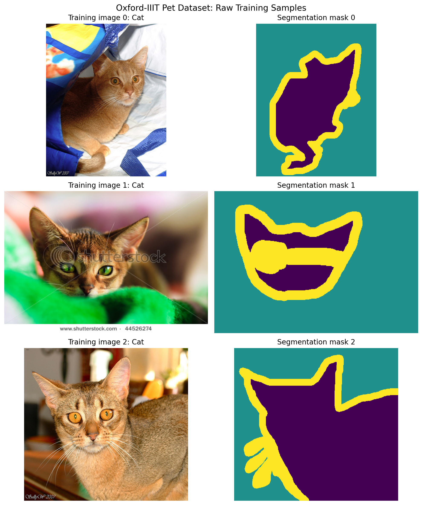
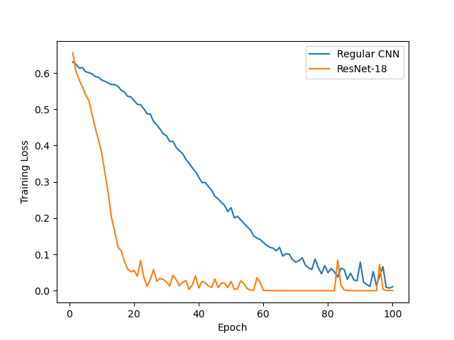
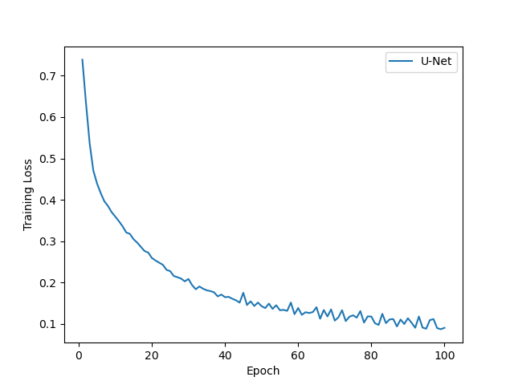
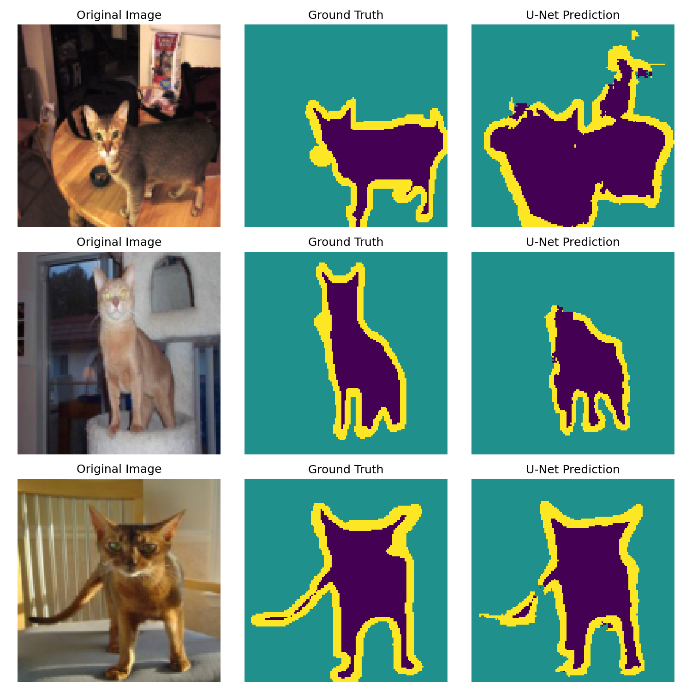

# **Introduction to Deep Learning**
Image Classification and Segmentation with CNNs

## **1. SET UP ENVIRONMENT**

## Install the dependencies using:
```
The project requires PyTorch, Torchvision, NumPy, Matplotlib, and tqdm.

python -m pip install torch torchvision numpy matplotlib tqdm
```
## Environment and hardware
```
- Execution environment: VS Code running under WSL2
- Hardware: NVIDIA Quadro P1000 GPU with approximately 4 GB of dedicated memory
- CUDA: Available; PyTorch reports CUDA 12.4
```
## Download the input (raw) data
```
Run python data.py from you working directory
```
## Run the code
```
Run the following commands from the project directory:

-Explore the dataset: python explore_data.py

-Train the classification models: python train_classification.py

-Train the segmentation model: python train_unet.py

-To run the model evaluation after calibration: python model_evaluation.py
```

## **2. DATASET INFORMATION**
```
Number of training samples: 3680
Number of testing samples:  3669

FIRST RAW TRAINING SAMPLE
Image dimensions (width, height): (394, 500)
Classification label: 0 (Cat)
Mask dimensions (width, height): (394, 500)
Unique mask values: [1 2 3]

See the first three training images beside their segmentation masks in Figure 1.

PROCESSED TRAINING BATCH
Images shape: torch.Size([16, 3, 128, 128])
Labels shape: torch.Size([16])
Masks shape:  torch.Size([16, 128, 128])
Image data type: torch.float32
Label data type: torch.int64
Mask data type:  torch.int64
Processed mask values: [0 1 2]
```


Figure 1. First three training images (left), their segmentation masks (right)

## **3. MODEL BUILDING AND TRAINING**
```
-Train the classification models: python train_classification.py

-Train the segmentation model: python train_unet.py
```

## **4. Model Evaluation**
```
Classification Results
| Model | Test accuracy |
|---|---:|
| Regular CNN | 78.74% |
| ResNet-18 | 81.90% |
| Always-Dog baseline | 67.76% |

U-Net Segmentation Results
Pixel accuracy: 86.20%
```
## **5. Analysis and interpretation**
```
1.1. ResNet-18 had a better performance (81.9 %) vs regular CNN (78.74%), with a difference of 3.16%. The CNN has three convolutional layers versus the many more convolutional layers of ResNet-18, for this reason, the second model was able to learn features that generalized better the classification of the images.
1.2. Both models achieve higher accuracy than the majority class baseline, demonstrating that they are capable of predicting classes beyond the most frequent one.
1.3. ResNet-18 has a more complex architecture than standard CNNs and achieved 3.16% superior performance.
```

Figure 2. Classification training loss


Figure 3. Classification training loss


Figure 4. Segmentation examples

